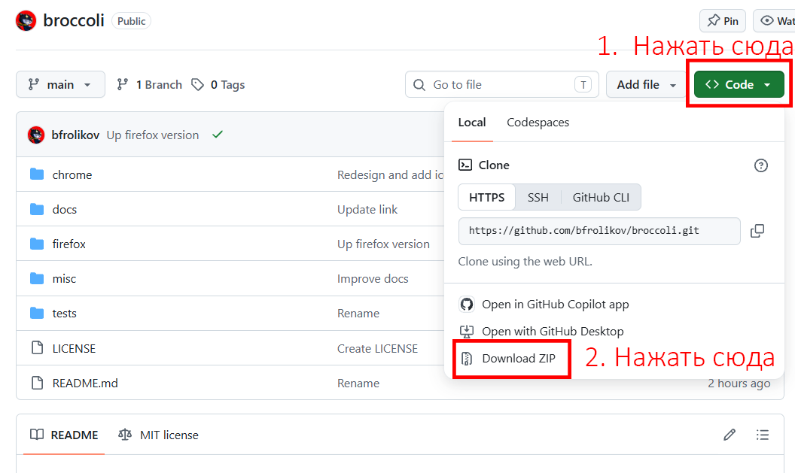
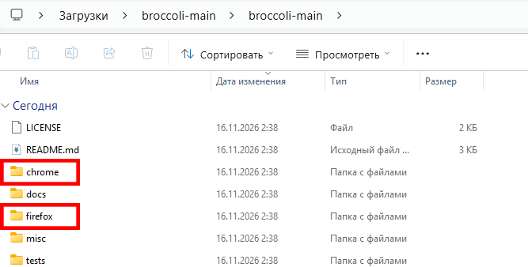

# 🥦 broccoli

Расширения для Chrome и Firefox, которые блокируют видео на YouTube по категориям.
## Что это и зачем
Ютуб, как известно, полон разного контента: от крайне полезного до крайне вредного. Хочется иметь способ себя как-то ограничивать (помимо силы воли, лол), не потеряв при этом доступ к туториалам, музыке, реально полезным видео и так далее. Поэтому сделал broccoli, который позволяет гранулярно выбирать категории разрешенных видео. Решения принимаются с помощью OpenAI Decisions API. Вводится список разрешенных к просмотру категорий видео (он привязан к аккаунту, поэтому нужен логин и пароль), остальные блокируются. 

**NOTE:** Расширения пока на стадии эксперимента. Для регистрации попросите админа (меня) добавить ваш email в список разрешённых.

## Как устанавливать
### Chrome
Заявка на публикацию в Chrome Web Store подана, но пока вручную: 
1. Скачать архив с репозиторием.

    * Нажать на зеленую кнопку `<> Code`.
    * Нажать на `Download ZIP`. 

    

2. Распаковать ZIP файл. Расширения для Chrome и Firefox лежат в соответствующих папках, см. картинку
    
    

3. Открыть меню браузера (три точки в правом верхнем углу) -> Расширения -> Управление расширениями (или ввести в адресную строку `chrome://extensions/`).
4. В правом верхнем углу страницы переключить тумблер «Режим разработчика» (Developer mode) в положение Вкл.
5. Нажать на кнопку «Загрузить распакованное расширение» (Load unpacked) в левом верхнем углу. В открывшемся окне выбрать папку `chrome` из распакованного архива (смотри выше).

### Firefox
1. https://addons.mozilla.org/addon/broccoli/ - из "магазина" расширений Firefox. Перейти по ссылке, добавить в свой браузер.

## Как пользоваться
1. Нажать **Create account**, указать одобренный email и придумать пароль. После регистрации расширение автоматически войдёт в аккаунт. Если аккаунт уже есть, нажать **Log in** и войти с email или ранее выданным именем пользователя.
2. Если забудете пароль, можно запросить на почту код для восстановления.
3. Ввести категорию через форму и нажать Add category. Выбранные категории видео будут разрешены, остальные - заблокированы.
    
    

## Дисклеймер

Я не умею и не люблю писать фронтенд, поэтому весь код тут, в отличие от бэкенда, сгенерирован с помощью Codex.
