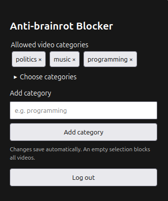

# Расширения для блокировщика YouTube по категориям
## Что это и зачем
Ютуб, как известно, полон разного контента: от крайне полезного до крайне вредного. Хочется иметь способ себя как-то ограничивать (помимо силы воли, лол), не потеряв при этом доступ
к туториалам, саундтрекам, реально полезным видео и так далее. Поэтому сделал блокировщик, который позволяет гранулярно выбирать категории разрешенных видео. Решения принимаются с помощью OpenAI Decisions API. Вводится список разрешенных к просмотру категорий видео (он привязан к аккаунту, поэтому нужен логин и пароль), остальные блокируются. Логин и пароль запрашивать у админа (меня).

## Как устанавливать

1. Скачать архив с репозиторием.
2. Распаковать. Расширения для Chrome и Firefox лежат в соответствующих папках.

### Chrome
1. Открыть меню браузера (три точки в правом верхнем углу) -> Расширения -> Управление расширениями (или ввести в адресную строку `chrome://extensions/`).
2. В правом верхнем углу страницы переключить тумблер «Режим разработчика» (Developer mode) в положение Вкл.
3. Нажать на кнопку «Загрузить распакованное расширение» (Load unpacked) в левом верхнем углу. В открывшемся окне выбрать папку `chrome` из распакованного архива.

### Firefox
1. Пока никак, для постоянной установки надо получить подпись от `addons.mozilla.org`.

## Как пользоваться
1. Залогиниться с выданным логином и паролем.
2. Ввести категорию через форму и нажать Add category. Выбранные категории видео будут разрешены, остальные - заблокированы.
    
    

## Дисклеймер

Я не умею и не люблю писать фронтэнд, поэтому весь код тут сгенерирован с помощью Codex.